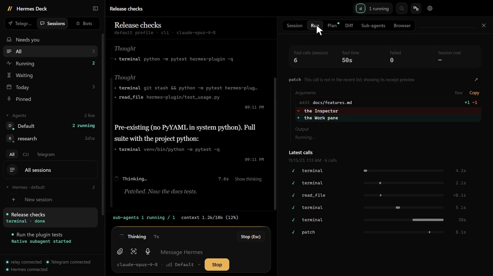
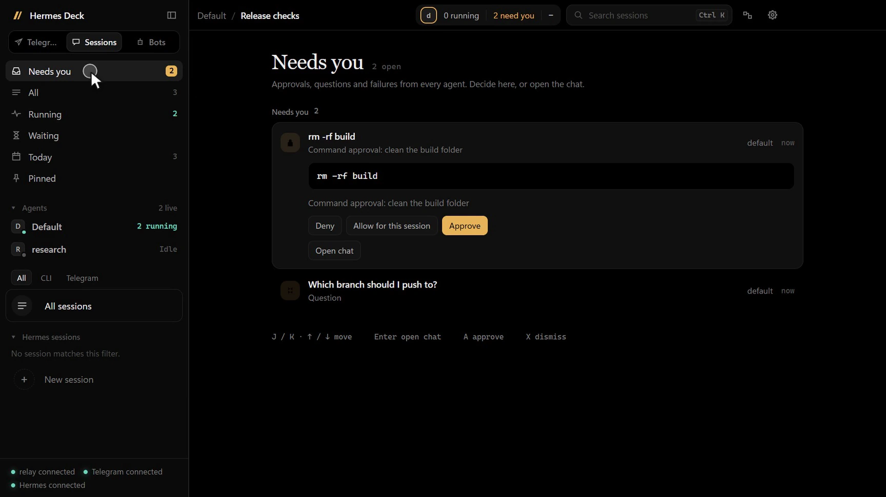
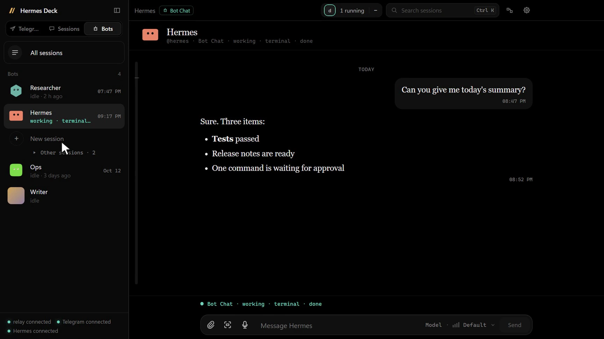
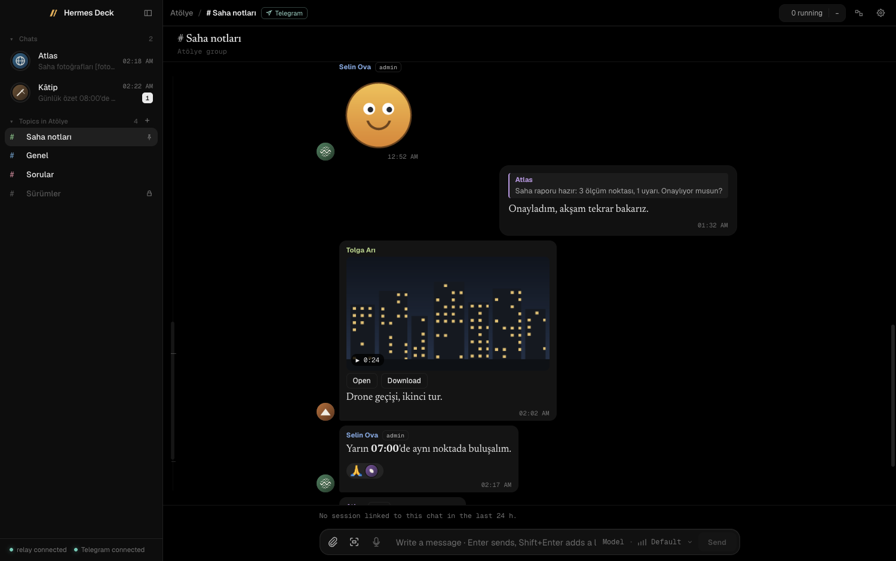
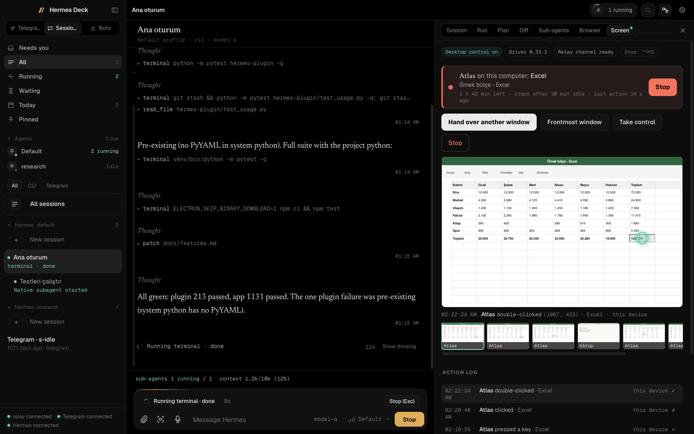
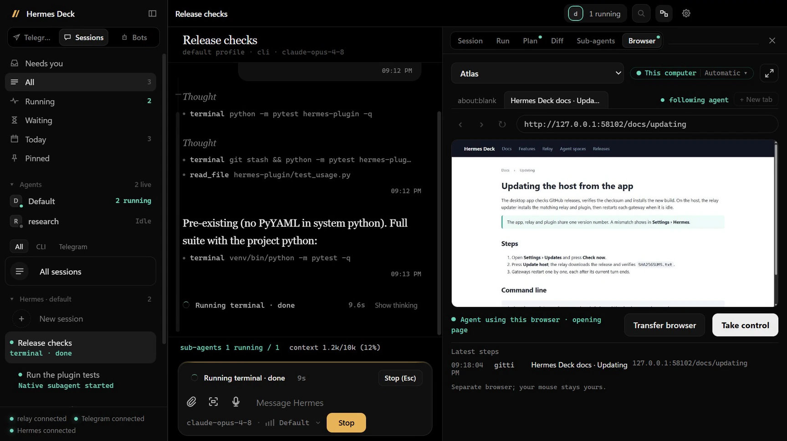
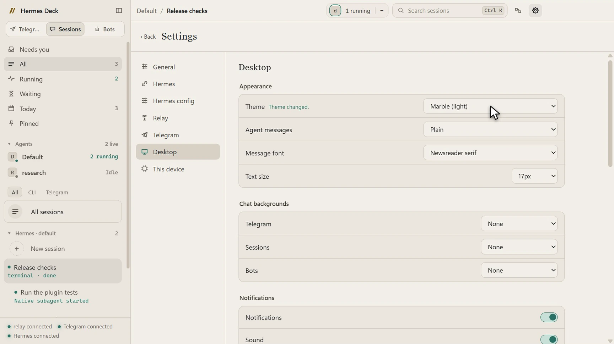

# Hermes Deck

<p align="center">
  
</p>

Hermes Deck is a desktop app for [Hermes Agent](https://github.com/NousResearch/hermes-agent). It lets you chat with
your Hermes agents, see what they are doing right now (thinking, tools, sub-agents), steer or stop them, and keep an
eye on usage and subscription limits, all from one window on your Windows or macOS computer. It connects to the
Hermes instance you already run, over SSH, WSL or locally, through a small Hermes plugin. An optional relay on the
Hermes host adds a live view of every agent, host-wide usage, and letting agents use a browser or one window on your
computer, both off until you allow them. Telegram is optional.

<table>
  <tr>
    <td width="50%"><br><b>Needs you</b>: approvals and questions from every agent in one inbox</td>
    <td width="50%"><br><b>Bot Chat</b>: every profile has its own chat and personality</td>
  </tr>
  <tr>
    <td width="50%"><br><b>Telegram mode</b>: your account, your bots, your group topics</td>
    <td width="50%"><br><b>Desktop control</b>: watch an agent work in one window, take control any time</td>
  </tr>
  <tr>
    <td width="50%"><br><b>Agent browsers</b>: the agent's own browser tab, live on your device</td>
    <td width="50%"><br><b>Themes</b>: dark, light and OLED themes, wallpapers, reading preferences</td>
  </tr>
</table>

## Features

| Feature | What it does | Needs relay? | Needs Telegram? |
|---|---|---|---|
| [Sessions](docs/features.md#sessions) | Browse, search and continue every Hermes session from every profile and platform | No | No |
| [Bots and Bot Chat](docs/features.md#bots-and-bot-chat) | One chat per Hermes profile, with its face, state and routines | Routines only | No |
| [Telegram mode](docs/features.md#telegram-mode) | Your bot DMs and one forum group's topics, inside Deck | For live activity | Yes |
| [Live activity](docs/features.md#live-activity-and-controls) | Thinking, current tool, sub-agents; queue, steer, interrupt, stop, take over | For the all-agents view | No |
| [Attachments, voice and drafts](docs/features.md#attachments-voice-notes-dictation-and-drafts) | Files, window captures, voice notes, dictation transcribed by Hermes, per-chat drafts | No | No |
| [Model and reasoning pickers](docs/features.md#model-and-reasoning-pickers) | Change the model or reasoning effort for one session | No | No |
| [Usage and quotas](docs/features.md#usage-quotas-and-fleet) | Tokens, cost and cache use over 24h–All; Claude/Codex limits; gateway health | Yes | No |
| [Notifications, pet, themes](docs/features.md#notifications-and-badge) | OS notifications, taskbar badge, status pet, themes, English/Turkish | No | No |
| [Agent browsers](docs/features.md#agent-browsers-browser-tab) | Watch an agent's browser live, take control, hand it back | Yes | No |
| [Desktop control](docs/features.md#desktop-control-screen-tab) | Let an agent use one window you hand over, with Stop always available | Yes | No |
| [Agent spaces](docs/features.md#agent-spaces) | Each agent on its own Linux desktop (or taking turns on a shared one); watch or join in, approve risky commands, undo changes | Yes | No |

Details of each feature, what it needs and where its settings are: [docs/features.md](docs/features.md).

## How it fits together

```text
Hermes + Deck plugin ←── SSH / WSL / local ──→ Deck app
        │ events + state                         ↕
        └────────→ optional relay ←─ token ────→ app
                                                 ↕
                                           optional Telegram
```

| Part | Runs on | Source |
|---|---|---|
| Hermes plugin | The Hermes host, inside each Hermes profile | [hermes-plugin/hermes-deck](hermes-plugin/hermes-deck/README.md) |
| Relay (optional) | The Hermes host | [relay](relay/), guide: [docs/relay.md](docs/relay.md) |
| Desktop app | Your Windows or macOS computer | [app](app/) |

More: [docs/architecture.md](docs/architecture.md).

## Install

### Option A: give it to your Hermes

Hermes Deck ships a setup skill that your own Hermes agent can follow on its host. Give your agent this prompt:

> Install Hermes Deck on this host from https://github.com/Hermes-Deck/hermes-deck. Use its
> skills/hermes-deck-setup skill. Ask me before changing any profile or starting services.

The skill checks your Hermes installation, shows the plugin installer's plan before applying it, optionally sets up
the relay, and prints the values to enter in the app. It asks before every change and never restarts a busy
gateway. Your agent can read it from a clone, or you can install it into Hermes first:

```bash
hermes skills install Hermes-Deck/hermes-deck/skills/hermes-deck-setup
```

To check a host at any time, run the read-only doctor from a clone with Hermes' Python:
`<hermes-python> scripts/doctor.py` (`--json` for agents, `--home <hermes-home>`, `--relay http://<relay-host>:9330`).
Details and the manual equivalent: [docs/install-with-hermes.md](docs/install-with-hermes.md).

Then install the desktop app (step 2 below) and complete its first-start setup (step 3).

### Option B: manual

**1. Install the plugin on the Hermes host.** From a clone of this repository, with Hermes' own Python (the
interpreter of your Hermes installation):

```bash
cd hermes-plugin/hermes-deck
<hermes-python> install.py --dry-run   # shows the plan, changes nothing
<hermes-python> install.py
```

The installer backs up each changed `config.yaml`, enables `hermes-deck` in the selected profiles (`--profile NAME`,
default: all) and writes the direct-connection entry point to `<Hermes home>/hermes-deck/stream.py` (normally
`~/.hermes/hermes-deck/stream.py`). Restart each affected gateway only when its foreground and background work has
finished; a restart also ends background sub-agents. Options: [plugin README](hermes-plugin/hermes-deck/README.md).

**2. Install the desktop app.** Download from [Releases](https://github.com/Hermes-Deck/hermes-deck/releases/latest):

| System | File |
|---|---|
| Windows x64 | `Hermes-Deck-<version>-Setup.exe` (recommended) or `Hermes-Deck-<version>-win-x64.zip` |
| macOS Apple Silicon | `Hermes-Deck-<version>-mac-arm64.dmg` |
| macOS Intel | `Hermes-Deck-<version>-mac-x64.dmg` |

Builds are not code-signed (macOS builds are ad-hoc signed, not notarized). Check the download against the release's
`SHA256SUMS.txt` first:

```powershell
Get-FileHash .\Hermes-Deck-<version>-Setup.exe -Algorithm SHA256
```

```bash
shasum -a 256 Hermes-Deck-<version>-mac-arm64.dmg
```

On Windows, Setup installs per user without admin rights and adds Start menu and Desktop shortcuts (Windows
notifications need the Start menu shortcut). On macOS, drag the app to Applications. SmartScreen or Gatekeeper asks
once; approve only a download you verified.

**3. First-start setup.** The app walks you through:

1. **Chat modes**: Telegram, Sessions, Bots or a combination, and which one opens at start.
2. **Connect to Hermes**: SSH (another machine), WSL (Windows) or Local (macOS/Linux); the SSH target, the Hermes
   Python path and the `stream.py` path from step 1; **Test connection**. SSH uses your existing key login and
   `known_hosts`; Deck never prompts for passwords.
3. **Relay (optional)**: its address and token, or **Set up later**.
4. **What may run on this device?**: **Allow agent browsers** and **Allow desktop control**, both off by default.
5. **Make it yours**: status pet, notifications and language, then **Finish setup**.

With Telegram mode on, Telegram's API-key and phone login screens follow. Everything can be changed later in
**Settings** (gear in the top bar, or **Ctrl+,** / **Cmd+,**).

**4. Relay (optional).** Run it on the Hermes host, bound to loopback or a private network address only, then enter
`ws://<relay-host>:9330` and its token in **Settings → Relay**. Setup for Linux and macOS: [docs/relay.md](docs/relay.md).

## Updating

- **Desktop app:** **Settings → General → Updates**. On Windows, Deck downloads the new installer, checks it against
  `SHA256SUMS.txt` and installs it. On macOS, install the new DMG from the release page.
- **Relay and plugin:** update them on the Hermes host to the same version as the app. The app tells you when they
  are behind and shows the command. See [docs/updating.md](docs/updating.md).

## Requirements

- Hermes Agent at or above the version in [`compat.json`](compat.json) (`minHermes`), on Linux, macOS or WSL.
- Python 3.10+ with PyYAML for the plugin installer (Hermes' own Python has it).
- Node.js 22.13+ for the relay.
- Windows x64 or macOS (Apple Silicon or Intel) for the desktop app.
- For Telegram mode only: your own API keys from [my.telegram.org](https://my.telegram.org/apps).
- For agent desktops only: Docker (Docker Desktop, Docker Engine or colima) on the computer that hosts them.

App, relay and plugin share one version; run the same version of each. Full matrix and the version/protocol rules:
[docs/compatibility.md](docs/compatibility.md).

## Security model

- **The relay never goes on the internet.** Bind it to loopback or a private network (Tailscale, WireGuard). Its
  token grants access to every agent's sessions and history.
- **Device permissions start off.** Agent browsers and desktop control run on a computer only after its owner turns
  them on locally; the relay cannot enable them, and desktop control is limited to one window you hand over.
- **Tokens are stored encrypted.** The relay token, Telegram session and device key are kept in the app's main
  process with the OS keychain (Electron `safeStorage`); the UI never receives them.
- **Builds are unsigned, so verify them.** Each release publishes `SHA256SUMS.txt` and a build provenance attestation
  for its files.

More: [SECURITY.md](SECURITY.md) (reporting vulnerabilities) and [docs/security.md](docs/security.md).

## Documentation

- [Features](docs/features.md), [compatibility](docs/compatibility.md), [updating](docs/updating.md)
- [Relay and device tools](docs/relay.md), [host-wide usage](docs/host-usage.md), [agent spaces](docs/agent-spaces.md)
- [Architecture](docs/architecture.md), [desktop-control protocol](docs/bot-screen-protocol.md),
  [security notes](docs/security.md)
- [Development](docs/development.md): running from source, tests, fixtures and builds

## Contributing

Contributions are welcome. Read [CONTRIBUTING.md](CONTRIBUTING.md) for setup, tests and the pull-request flow.
Coding agents: see [AGENTS.md](AGENTS.md). User-visible changes are listed
in [CHANGELOG.md](CHANGELOG.md).
