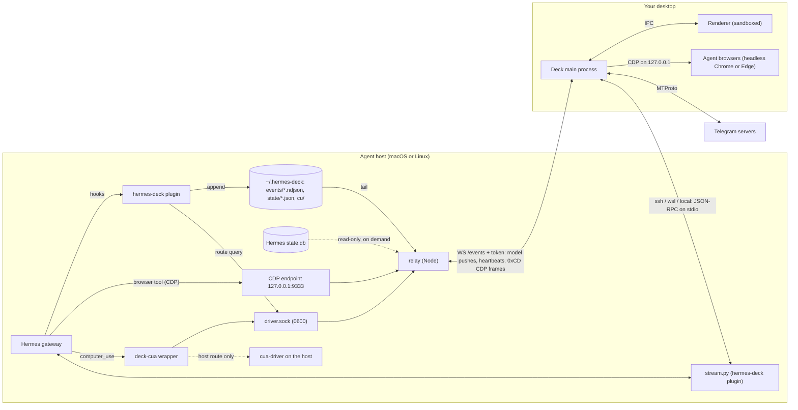

# Hermes Deck architecture

Hermes Deck has three core parts. The **hermes-deck plugin** runs inside Hermes on the agent host: it writes what the agents do to plain files and serves the Deck's direct Hermes connection. The optional **relay** runs on the same machine, turns those files into a live model and serves it over one authenticated WebSocket. The **app** (the Deck) is an Electron program on your desktop. It talks to Hermes directly over SSH, WSL or a local process, shows the relay's live model, and can also show your Telegram bot chats.

This document describes the code on `main`. What each feature does for the user is in [`features.md`](features.md). The bot screen's protocol is in [`bot-screen-protocol.md`](bot-screen-protocol.md); this file only summarizes it.

## Components

| Part | Runs on | Folder | Job |
|---|---|---|---|
| hermes-deck plugin | agent host, inside each Hermes profile | `hermes-plugin/hermes-deck/` | Events part: appends one JSON line per turn, tool call, API call and sub-agent, writes a gateway and cron snapshot every 30 s, and fences `computer_use` when a profile opts into the bot screen. Bridge part: live session snapshots and a private control socket that `stream.py` relays to the Deck's direct connection. |
| relay | agent host | `relay/` | Tails the plugin's files, keeps the session model and token rollups, reads message history on demand, routes agent browsers and bot-screen sessions to devices. |
| app | your Windows or macOS desktop | `app/` | Direct Hermes connection, live activity views, usage, Telegram client, agent browsers, desktop control, status pet, tray and notifications. |

### hermes-deck plugin

`hermes-plugin/hermes-deck/` combines relay events and the direct bridge. Its `install.py` backs up each profile's `config.yaml`, enables the plugin in the selected profiles (all by default), disables a leftover `deck-events` entry from older installs and can restore it on uninstall. `__init__.py` registers both parts; on the hooks they share, each part runs and a failing one is logged and skipped.

The events part, `events.py`, registers Hermes hooks (`pre_llm_call`, `post_llm_call`, `pre_tool_call`, `post_tool_call`, `post_api_request`, `post_auxiliary_call`, `subagent_start`, `subagent_stop`, `on_session_start`, `on_session_end`, `agent_loop_stopped`). Each hook appends one line to `~/.hermes-deck/events/<profile>.ndjson`:

- `turn_start`, `turn_end`, `tool_start`, `tool_end`, `llm`, `aux`, `sub_start`, `sub_stop`, `session_start`, `session_end`, `stopped`;
- `plan`, after a successful `todo_list`, `todo` or `omh_todo` call (see [Work pane data](#work-pane-data-plans-tool-calls-sub-agents));
- the gateway routing context of the turn (`platform`, Telegram `chat` and `thread`, session key `skey`, `cron`);
- token usage as Hermes reports it.

Argument and result previews are cut at 300 characters, and common secret shapes are redacted. The file rotates to `.ndjson.1` past 50 MB. Every handler swallows its own errors and returns nothing, so the plugin never changes a turn, with one opt-in exception: the bot screen's `computer_use` fence (see below).

The gateway process also writes `~/.hermes-deck/state/<profile>.json` every 30 s: gateway state, platform states, and a cron job summary. CLI and cron worker processes stop trying after three misses.

The bridge part, `observer.py` (derived from Hermes Desk), keeps snapshots of the live sessions in `<HERMES_HOME>/hermes-deck/processes/<pid>.json`: state, model, tool names, bounded and redacted titles and context use, never prompts or tool payloads. Next to each snapshot, `<pid>.activity` holds the work pane's data per session: the latest plan and the last 20 tool calls (300-character redacted previews), written only when it changes. It also opens a Unix socket next to them (mode 0600) that accepts native steer, redirect and interrupt for the running agent, read-only history, and an allowlist of Hermes' TUI-gateway methods. `stream.py` relays the Deck's requests to that socket (see the SSH bridge below). `HERMES_DECK_BRIDGE=0` turns the bridge part off.

### Relay

`relay/src/index.js` reads its settings from `relay/.env` (or the file in `DECK_RELAY_ENV`) and refuses to start with a token shorter than 24 characters.

| Module | Job |
|---|---|
| `tailer.js` | Polls each NDJSON file every second. Handles partial lines, rotation and truncation. On restart it replays up to 2 MB before the saved checkpoint with `live=false`, so state is rebuilt but nothing is counted twice. |
| `claude.js` | Optional: turns Claude Code transcripts from `CLAUDE_PROJECT_DIRS` into the same event shape, including sub-agents and a `cost` event. |
| `model.js` | Sessions, their state, current tool, last 30 tool calls, latest plan, sub-agent tree, tokens, context fill, and per-day rollups by agent and model. A running session silent for 45 min in a tool (15 min between tools) is shown as stale. Finished sessions go after 24 h idle; day rollups older than 400 days fold into month rollups; 5-minute rollups (rolling 24 h) are kept 48 h. |
| `provenance.js` | Labels `delegate_task` children with their OMH route (model, provider, effort) when `omh_delegate_route` prepared it. |
| `fleet.js` | Reads the plugin's state snapshots (10 s), `launchctl list` on macOS for `DECK_LAUNCHD_PREFIXES` (15 s), and Claude/Codex usage windows through the CodexBar CLI (5 min). |
| `plan.js` | Checks each `plan` event again (bounds, states, redaction) and, on request, rebuilds a stored session's plan from its newest `todo_list` / `todo` / `omh_todo` result in `state.db` (read-only, through `usage.js`'s reader). |
| `history.js` | On request only: a session's messages and full tool calls from Hermes' `state.db` (opened read-only with `node:sqlite`, Node 22.13+) or from Claude Code transcripts. Fields are clipped to 4096 characters, a full message to 256 KB, and the same secrets are redacted. |
| `server.js` | HTTP and the `/events` WebSocket (routes below). |
| `presence.js` | Device heartbeats and routing for the `browser` and `desktop` capabilities. |
| `cdp.js`, `browser.js` | The Hermes-facing CDP endpoint, the CDP tunnel over a deck's connection, and the optional headless fallback browser on the relay host. |
| `driver.js`, `driver-wire.js`, `mcpfence.js`, `devtokens.js` | Bot screen, agent-host side: the local driver socket, device channels, the relay's MCP fence, device tokens, lease, stop and frames. |
| `spaces.js`, `space-lock.js`, `space-fetch.js`, `space-mcp.js` | Agent spaces: the shared desktop's lock and queue, the viewer proxy, the Deck's `/spaces` API, and the MCP bridge for `space` routes. |
| `desktops.js`, `space-tunnel.js` | Agent spaces phase 2: per-agent desktop lifecycle, home hosts, limits and fallback; the `[0xD6]` tunnel to Deck-hosted desktops. |

The checkpoint and rollups are saved to `relay/data/checkpoint.json` every 30 s and on shutdown.

HTTP routes (all but `/health` need `Authorization: Bearer <token>`):

| Route | Answer |
|---|---|
| `GET /health` | `{ok, v, uptime, clients, sessions}`. No token. |
| `GET /snapshot`, `/fleet`, `/tokens?range=24h\|7d\|14d\|30d\|all` (legacy `?days=N`) | The model, fleet health, token rollups for one Token-pane range. |
| `GET /session/<sid>` | One session with its recent tools, children and `plan` (live, else rebuilt from `state.db`). |
| `GET /session/<sid>/plan` | `{sid, plan, stored}`: the session's latest plan, also for a stored session the model no longer holds. `plan` is `null` when the agent published none. |
| `GET /session/<sid>/messages`, `/session/<sid>/call/<id>`, `/message/<id>/full` | Message history (off with `DECK_HISTORY=0`). |
| `POST /desktop/lease`, `POST /desktop/stop`, `GET /cu/<frame>` | Bot screen: Hermes' Bot Desktop lease, stop, stored frames. |
| `POST /fleet/quotas/refresh` | Ask the plugins for fresh quota windows (at least 30 s apart). |
| `/bundle/...` | Encrypted browser-transfer bundles between devices. |
| `/spaces`, `/spaces/route`, `/spaces/control`, `/spaces/mode`, `/spaces/host/view/` | Agent spaces (only with `DECK_SPACES`). |
| `/mobile/pair`, `/mobile/...`, `WS /mobile/bridge` | iOS app: single-use pairing, then its own mobile token for a subset of routes. |
| `WS /events` | Token in the `Authorization` header (`?token=` only with `DECK_RELAY_QUERY_TOKEN=1`). |

### App

The main process (`app/main/`) owns every connection and every secret. The renderer (`app/renderer/`) is plain DOM with no framework.

| Main module | Job |
|---|---|
| `main.js` | Window, `deck://` protocol for the renderer files, IPC handlers (every renderer input is checked here), single-instance lock. |
| `relay.js` | WebSocket client for the relay. Reconnects with backoff from 1 s to 30 s; also does the HTTP reads. |
| `telegram.js`, `reactions.js`, `secret.js`, `media.js` | Telegram over MTProto (teleproto, layer 229) and its message reactions, the encrypted session, the media cache. |
| `bridge.js` | Direct Hermes connection over SSH, WSL or a local process. |
| `presence.js` | This device's id, its hosting switches and the heartbeat. |
| `workspace.js`, `agent-browser.js`, `cdp-tunnel.js` | Agent browsers, their live view, and the deck end of the CDP tunnel. |
| `cua/` | Bot screen, device side: the driver channel (`channel.js`, `wire.js`), the private bounded cua-driver (`driver.js`, `manifest.js`), install and signature checks (`installer.js`, `pins.js`, `unzip.js`), grants, the window list, the activity bar (`bar.js`) and Stop (`index.js`). |
| `ipc-guard.js` | Sender check for every main-window IPC channel: only Deck's own top-level page may call them. |
| `spaces.js`, `space-proxy.js`, `space-view.js` | Agent spaces: status and control level from the relay, the local viewer proxy, the isolated viewer view. |
| `browser-transfer.js`, `browser-bundle.js` | Consent-based transfer of an agent browser's tabs, cookies and storage between devices, encrypted for the target. |
| `update-check.js`, `update-service.js`, `updates.js` | App update check and install (release + `SHA256SUMS.txt`), and the notices driven by the relay's version. |
| `history.js` | IPC for the sub-agent views; reads go to the relay. |
| `desktops.js`, `desktop-host.js`, `space-tunnel.js`, `space-proxy.js`, `space-view.js` | Agent spaces phase 2, device side: hosting agent desktops on this computer (consent, Docker state, isolation, limits), the tunnel end of the relay's `[0xD6]` frames, the loopback viewer proxy and the isolated viewer. |
| `desktop.js`, `notify.js`, `pet.js`, `tray.js`, `autostart.js` | Notifications, status pet, tray icon, start at login. |
| `settings.js` | `settings.json` in the app's data folder; secrets encrypted with Electron `safeStorage`. |

| Renderer file | View |
|---|---|
| `shell.js` | The Blend frame and its `window.DeckShell` API: sidebar (modes, filters), top bar, main area (chat or inbox), the right slot (Inspector or Work pane, one at a time, with tabs), named slots, events, shared services and the frame shortcuts. Later modules plug in through it. |
| `app.js` | Sidebar rail, chat column, the Inspector's Session, Activity and Usage tabs, the direct Hermes views, and the services other modules use (`h`, `chat`, `openChat`, `triageData`, …). |
| `settings-view.js`, `chat-modes.js`, `i18n.js` | The Settings view (General, Hermes, Relay, Telegram, Desktop, This device), the chat-mode editor, and the English and Turkish UI strings. |
| `sessions-browser.js`, `bots.js`, `activity-view.js`, `live-activity.js` | All sessions; the Bots mode and Bot Chat; the Activity tree; the live "working" row in a Hermes chat. |
| `outbox.js`, `busy-send.js`, `takeover.js`, `drafts.js`, `attach.js`, `voice.js`, `voice-bubble.js`, `hermes-files.js`, `media-preview.js` | Composer: queued messages, queue-or-steer, explicit take over, per-chat drafts, attachments, dictation, voice notes, files offered by the agent, image previews. |
| `msgview.js`, `reactions.js`, `markdown.js`, `topics.js` | Message bubbles, media, inline buttons, context menu, reply bar; reaction chips and the quick picker; agent markdown as DOM nodes; forum topic management. |
| `agents.js` | Sub-agent views: session detail, everything running now, full tool calls, the sub-agent tree with retries, role labels, folded prompt context. |
| `model-picker.js` | The composer's model · effort token left of Send and its popover (search, provider groups, custom model id; reasoning level and Show thinking). Session-scoped. |
| `composer.js`, `receipts.js`, `timeline.js`, `think-block.js` | The composer status row, tray and "via" line; per-turn tool-call receipts; the timeline scrubber; reasoning folds. |
| `work-pane.js` | The Work pane's Run, Plan, Diff and Agents tabs and the live Browser/Screen surface chips. |
| `inbox.js`, `fleet-capsule.js` | The inbox (Needs you) and the top-bar fleet capsule and panel. They share one read model fed by bridge and relay pushes; answers use the existing `request.answer` path. |
| `tokens-view.js`, `usage-view.js` | The Inspector's Usage tab: quotas, today's usage, token ranges and cost breakdowns. |
| `workspace.js` | The Work pane's Browser tab and the agent-browser rows of Settings → This device. |
| `botscreen.js`, `space-panel.js` | The Work pane's Screen tab (the agent's frames with click markers, the action log), the Hand to agent consent sheet, the Desktop control rows of Settings → This device, and the agent-space panel. |
| `botbar.html`, `botbar.js` | The always-on-top bar shown while an agent may act on this computer. |
| `pet.html`, `pet.js` | The status pet window. |

## Data flow



The dotted host route runs only when `DECK_DESKTOP_HOST=1`. Device driver frames (`0xD5`) ride the same `/events` connection as the CDP frames and are left out of the diagram (see [Bot screen](#bot-screen-the-driver-channel)).

### Agent activity: plugin, relay model, WebSocket, Deck

1. A Hermes hook fires and the plugin appends one line to `events/<profile>.ndjson`.
2. The relay's tailer reads the line within a second. `index.js` normalizes the usage fields, adds the agent's display name from `relay/agents.json`, and applies the event to the model.
3. Every 250 ms, when something changed, the relay broadcasts `{t:"evs", evs, sessions, agents}`: the raw events (only those younger than 5 minutes) and fresh summaries of every changed session, so clients never re-derive state. It also pushes `{t:"agents"}` every 60 s, `{t:"fleet"}` when fleet health changes, and `{t:"devices"}` when presence changes.
4. A new WebSocket client gets `hello`, then a `snapshot` (the 300 latest sessions, agents, fleet, 7 days of tokens), then the device state. A client more than 4 MB behind is cut and resyncs on reconnect. The server pings every 30 s.
5. The Deck's main process passes each message to the renderer on the `relay` IPC channel, and to `desktop.js`, which turns finished sessions into notifications.
6. The renderer links sessions to chats. A bot DM belongs to the agent whose `bot` in `agents.json` matches the bot's username. A topic belongs to sessions whose Telegram `chat` is the configured group and whose `thread` is the topic id.
7. Opening tool lists, a session detail or a tool call asks the relay over HTTP (`/session/...`, `/message/...`) with the same token.

Watching costs no LLM tokens: nothing in this path asks an agent for its status.

### Telegram: MTProto in the Deck

In Telegram mode, a bot DM that is not a Hermes agent and has a username offers **Hide from list** through right-click, the ContextMenu key or Shift+F10. This saves the username in `hiddenBots`, merging without case-sensitive duplicates; the row disappears and a short toast points to Settings. **Settings > Telegram > Hidden bots** lists saved usernames with a **Show** button for each, plus a username input and **Hide** button. Manual additions trim whitespace and accept an optional `@`; up to 50 bots can be hidden. Existing saved lists and the default `BotFather` entry are preserved. Changes use the existing settings save path, which restarts Telegram to reload dialogs; the renderer also filters the rail using saved settings while retaining the incoming dialog snapshot so Show survives reconnect ordering.

`telegram.js` signs in with the user's own account through [teleproto](https://www.npmjs.com/package/teleproto), the maintained successor of GramJS, on MTProto layer 229. `app/package.json` pins it to one exact version because it holds the session's auth key. The login asks for the phone number, the code and, when set, the two-step password. It refuses to sign up a number that has no account. The session string is encrypted with `safeStorage` into `tg.session.enc` in the app's data folder and never leaves the main process. A saved session counts as dead only when Telegram says so (`AUTH_KEY_UNREGISTERED`, `SESSION_REVOKED` and similar); a network error does not sign the user out.

The service lists bot DMs from the first 300 dialogs (minus hidden bots) and, if one is chosen in Settings, one forum supergroup's topics. Chat keys are `u<botId>` and `t<topicId>`. It reads history, sends text (as a reply when asked), presses inline buttons on a click, sets the user's own reactions on a click (`messages.sendReaction`; star reactions stay in Telegram), manages topics when the account may, and downloads media only when shown or asked for, up to 25 MB, into `media/`. Bot API rich messages are reduced to plain data in the main process (`richOf`: paragraphs, lists, tables, quotes, photos, documents, button rows and more) and drawn in place; a block it cannot draw becomes an "Open in Telegram" note, and a rich message delivered in part is fetched whole. Reactions (`main/reactions.js`) become chips under each bubble and follow `UpdateMessageReactions` live; reactors' photos come through the same avatar cache as group senders. Read receipts (C5): when the user actually looks at a chat (selected, window visible and focused, messages scrolled into view) the renderer reports the newest message on screen (`renderer/readsync.js`); `main/readsync.js` batches and debounces those marks, holds them while the window is in the background, and sends `messages.readHistory` for bot DMs or `messages.readDiscussion` (topic id as `msg_id`) for topics, never `channels.readHistory`. Read updates from other devices (`UpdateReadHistoryInbox`, `UpdateReadChannelDiscussionInbox`, `UpdateReadChannelInbox`) lower the badges, and every count is read again after a reconnect. The `readReceipts` setting (on by default) turns sending off; badges are then tracked locally. It touches no other chat. Telegram traffic goes from the Deck straight to Telegram; the relay never sees it.

### Direct Hermes connection: the SSH bridge

`bridge.js` runs one child process that starts `stream.py --follow` on the Hermes host. That script is part of the hermes-deck plugin (`hermes-plugin/hermes-deck/stream.py`; the installer writes it to `<Hermes home>/hermes-deck/stream.py`, normally `~/.hermes/hermes-deck/stream.py`) and relays requests to the plugin's control socket inside each Hermes process. The observer, stream and app use the `hermes-deck.v1` snapshot schema; the stream discovers `<HERMES_HOME>/hermes-deck/` for each profile.

| Mode | Process |
|---|---|
| SSH | `ssh -T -o BatchMode=yes -o ConnectTimeout=8 ... <target> "exec <python> -I <stream.py> --follow"` (Windows OpenSSH or `/usr/bin/ssh`) |
| WSL (Windows) | `wsl.exe [--distribution X] --exec /bin/sh -c "exec ..."` |
| Local (macOS, Linux) | `<python> -I <stream.py> --follow` |

Both directions speak newline-delimited JSON-RPC 2.0 on stdio. The host sends `hermes-deck.v1` snapshots (at least every 5 s while healthy), native events, approval and question requests, and replies. The Deck sends only the methods allow-listed in `app/main/bridge.js` (`READS` and `MUTATIONS`), each with validated parameters. Reads include `session.list`, `deck.session_index`, `session.messages`, `session.usage`, `model.options`, `profiles.list`, `profiles.get_asset`, `deck.transcribe` (dictation), `deck.file_read` (downloads of files the agent offered), and the work pane's `subagent.list`, `subagent.tail` and `deck.plan`. Mutations include `session.create`, `session.resume`, `deck.takeover`, `prompt.submit`, `deck.attach_submit`, `native.steer`, `native.redirect`, `native.interrupt`, `session.interrupt`, `config.set` (the session's model with `--session`, never `--global`, or its reasoning level), `request.answer`, and the session-management calls (`session.title`, `session.delete`, `session.archive`, `session.branch_stored`, …), and `subagent.steer` / `subagent.interrupt` for one child of a session. Mutations only follow a click and are never replayed: a request whose connection drops fails and says it may have run. The bridge works without the relay and without Telegram.

### Work pane data: plans, tool calls, sub-agents

The work pane's Plan, Run and Agents tabs read the same data on both paths. The plan path: the plugin's `plan` event → the relay's session model (and `deck.plan` on the direct stream) → the app (`bridge.plan`, else the relay's `sessionPlan`); with no live plan, the relay or plugin rebuilds it from `state.db`.

**Plans.** When a `todo_list`, `todo` or `omh_todo` call succeeds, `events.py` parses the full result. It never raises and never blocks the call. It then appends one `plan` line: `{ev:"plan", sid, source:"todo"|"omh", rev, items:[{id, text, state, depth, phase?, blocked?}], total?}`.
- Item limits: at most 64 items, text cut at 300 characters and redacted, and `depth` capped at 3.
- `state` is one of `pending`, `active`, `done` or `cancelled`.
- `total` is set only when the list was cut.

The relay keeps the latest plan for each session. An older `rev` from the same source never replaces it. Snapshot rows carry only a summary, `planInfo`: `{source, rev, ts, n, done, active, cur}`. The full plan is returned by `/session/<sid>` and `/session/<sid>/plan`.

If the relay has no live plan for a session, `plan.js` rebuilds it from `state.db`. It reads the newest active todo result of that session, then of the sessions it continues after compression (sub-agent parents are not followed). Answers are cached for 30 s. The store is opened read-only. When an in-place read would create files next to it, a bounded private copy is read instead.

On the direct connection, `stream.py` sends `deck.plan` events (`{plan}`) from the observer's `<pid>.activity`, keyed by the stored session id, once per change. For a stored session, the `deck.plan` read asks the plugin to rebuild the plan from that profile's `state.db`.

**Tool calls (Run tab).** Each tool call carries tool, call id, args preview, status, duration, error and result preview:
- relay path: `tool_start` and `tool_end` give the last 30 calls in `/session/<sid>` `recent`;
- direct path: the stream sends `deck.tools` events (`{tools}`) with the last 20 calls of a session, also once per change.

**Sub-agents (Agents tab).** `subagent.list`, `subagent.tail`, `subagent.steer` and `subagent.interrupt` go to Hermes' TUI gateway for one runtime session.
- Hermes checks that each child belongs to that session.
- The plugin checks the parameter shapes, then completes the list and tail replies: the child's session id, reasoning effort, state, elapsed seconds, tokens, cost, context use and its last tool calls. Everything is bounded and redacted.
- Steer text is limited to 32,000 characters.
- Steer and interrupt are mutations: they follow a click and are never replayed.

The app exposes all of this through `window.deck`:
- `bridge.subagents`, `bridge.subagentTail`, `bridge.steerSubagent`, `bridge.interruptSubagent`, `bridge.plan` and `bridge.toolCalls`;
- the relay's `sessionPlan`.

Every channel goes through `ipc-guard.js`.

### Agent browsers: the CDP tunnel

Hermes on the agent host points a profile's browser tool at `browser.cdp_url: http://127.0.0.1:9333/agent/<profile>`.

1. Hermes asks for `/json/version` there. The relay picks the agent's host with presence (capability `browser`).
2. The relay sends the request as a binary frame `[0xCD][op][channel u32][payload]` over that deck's own `/events` connection. Ops: `OPEN`, `OPENED`, `DATA`, `CLOSE`, `HTTP`, `HTTP_RES`.
3. The deck's `CdpTunnel` starts the agent's browser if needed, answers discovery, and carries each CDP socket to `127.0.0.1:<port>` of that browser. The relay rewrites WebSocket URLs in discovery answers to point at itself, so Hermes never sees the browser's port.
4. The Browser tab (Work pane) watches the same browser through a CDP screencast (JPEG frames) and sends the user's input only while the user holds control.

Each agent gets its own headless Chrome or Edge, with its own profile in `agent-browsers/<profile>` in the app's data folder and `--remote-debugging-port=0`. A browser nobody used or watched for 15 minutes is closed, and all of them close when the Deck quits.

The deck refuses, per CDP message:
- anything while agent browsers are switched off on this device;
- paths other than discovery and `/devtools/{browser|page}/<id>`;
- `file://` and other non-web URLs, file choosers, dragged files, extensions, web app installs, port tethering, and handing CDP to pages;
- downloads outside the agent's own `Downloads` folder (the path is rewritten);
- `Input.*` and navigation methods while the user holds control (reading the page still works).

By default (**Automatic**, `DECK_BROWSER_DEFAULT=host`) the relay routes an agent's browser to the agent host's browser, even when a deck qualifies; a deck hosts only when the user pins it (**This computer**) or the agent host has no browser for that agent. `DECK_BROWSER_DEFAULT=device` restores the earlier order (active deck first, agent host second). The agent host's browser is one of two kinds (`relay/src/browser.js`, `FallbackHost`):

- **Headless** (`DECK_FALLBACK_BROWSER=1`): a headless Chrome per agent profile, with its own profile under `data/agent-browsers`, launched on demand and closed after 15 idle minutes.
- **External** (`DECK_FALLBACK_BROWSER_CDP=http://127.0.0.1:<port>`): one already running browser (for example a persistent headful Chrome run by its own service, with logged-in sites) attached over its loopback debugging port. It is shared by one agent profile (`DECK_FALLBACK_BROWSER_CDP_AGENT`, default `DECK_CDP_DEFAULT_AGENT`); other profiles use a deck or the headless kind. The relay only attaches and detaches: it never launches, restarts, closes or kills it, refuses `Browser.close`/`Browser.crash` from the agent, probes it every 5 s (attaching when it comes up, dropping the attachment when it goes away or restarts), and rewrites discovery so the agent never sees the external port. Presence knows which agents the fallback serves (`fallback.browser.agents` in the `devices` push).

Both kinds use the same discovery, tunnel-free CDP carrying, live view (`workspace.js`) and control gate: the agent is the controller by default, **Take control** makes the user's input the only input and the agent's clicks, typing and navigation are refused, **Hand to agent** returns it. With neither kind and no deck, Hermes gets HTTP 503 ("no workspace").

Moving between the agent host and the user's own PC is a pin change (`route` op: `here` / `agent-host` / `auto`), handled as a handoff: the agent's sockets are cut and it reconnects at the new place. Cookies and tabs only follow through the browser-transfer path (`browser-transfer.js`, consent required), which exports pages, cookies and storage over CDP; it does not copy the external browser's profile directory, so without that consent the PC starts a fresh browser.

### Bot screen: the driver channel

The bot screen lets `computer_use` drive one window on the user's device through a cua-driver inside the Deck. On the agent host:

- `relay/bin/deck-cua` replaces `cua-driver` for profiles that set `HERMES_CUA_DRIVER_CMD`. It asks the relay over `~/.hermes-deck/driver.sock` for a route: a device, the host, or none (exit 69 with a line the agent reads).
- The relay carries device sessions as `[0xD5]` frames on the deck's connection and checks every MCP message with `mcpfence.js`. Device tokens are issued with `node tools/device-token.js add <name>` and stored as hashes.
- The plugin fences `computer_use` in Hermes and stores the frames the agent saw in `~/.hermes-deck/cu/` (pruned after 24 h or past 500 MB).
- `POST /desktop/stop` ends sessions; `POST /desktop/lease` takes or releases Hermes' own Bot Desktop lease through `relay/tools/lease.py`.

On the device (`app/main/cua/`), everything is off until the user turns on **Settings → This device → Desktop control** (presence's `desktop` switch) and allows agents there:

- With the switch on and a device key saved, the Deck says `HELLO` on its relay connection. It reports `driverOk.desktop` in its heartbeat only while the relay answers `READY {ok:true}`.
- The driver is a pinned cua-driver (0.33.3; on Windows in `%LOCALAPPDATA%\hermes-deck\cua-driver\<version>\`, on macOS `~/Applications/CuaDriver.app`). The Deck installs it only after the user confirms, and checks its size, SHA-256 and publisher signature first. It runs as the Deck's own daemon in bounded mode, with a manifest naming only the handed app; each relay channel is one driver process pointed at that daemon (layer 3 of the fence).
- **Hand to agent** lists windows (capture thumbnails matched with the driver's `list_windows`), refuses the Deck itself and password managers, and needs the user's confirmation. A grant lasts at most 2 h and ends after 30 min idle, on lock or sleep, and on quit.
- While a grant is active, an always-on-top bar, a red tray icon and notifications show it. **Stop** (the bar, the tray, the tab, Ctrl+Alt+Shift+S or ⌃⌥⌘S) works locally first: channels closed, driver processes killed, the switch paused, `STOPPED`, then `POST /desktop/stop`.
- The Screen tab (Work pane) shows the frames the agent saw, with click markers, and an action log built from the relay's `cu` events. Frames come through the main process with the relay token.

With `DECK_DESKTOP_HOST=1` and no device available, `computer_use` runs on the agent host's own screen; otherwise the agent gets the "no device" answer. Frames, opcodes, fences, exit codes and consent defaults are in [`bot-screen-protocol.md`](bot-screen-protocol.md).

### Presence and routing

Every deck sends a heartbeat on its relay connection every 10 s, and at once on connect, suspend, resume, lock and unlock:

```json
{"t":"heartbeat","device":{"id":"<random hex>","name":"<hostname>"},"os":"win32","idleSec":12,"locked":false,
 "hosting":{"browser":true,"desktop":false},"driverOk":{"browser":true}}
```

The device id is random and kept in `device.json` in the app's data folder, with the hosting switches. Both switches are off on a new install. `driverOk.desktop` is true only while the relay has answered the driver channel's `HELLO` with `READY {ok:true}`.

`relay/src/presence.js` decides where agent work runs:

- **Active device for a capability:** the least idle device whose heartbeat is under 30 s old, that is unlocked, idle under 120 s, has the switch on and a working driver.
- **Routes are sticky.** The first use makes a route and it stays until the device is lost (disconnected, silent 30 s, switch off) or the session ends (5 min without use and no open socket). Every change bumps an epoch, and the CDP gateway and driver cut sockets that belong to a dropped or moved route.
- **Route keys.** Agent browsers are routed per profile slug. Bot-screen sessions use `p:<profile>/k:<gateway session key>`, else `p:<profile>/s:<session id>`, else `p:<profile>`.
- **Fallbacks** come only from the relay's `.env`: `DECK_FALLBACK_BROWSER` / `DECK_FALLBACK_BROWSER_CDP` for browsers, `DECK_DESKTOP_HOST` for the desktop. All are off by default. For the browser, the agent host is preferred over an active deck unless `DECK_BROWSER_DEFAULT=device`; the desktop capability is always device-first.
- `presence.handoff()` can move a route on purpose, but nothing in this version calls it.

The relay pushes `{t:"devices", devices, active, fallback, routes}` to every deck when this changes; the Browser tab uses it to say where an agent's browser runs.

## Agent spaces

Agents that use `computer_use` work on their own desktop, a space, instead of the user's (setup and behaviour: [`agent-spaces.md`](agent-spaces.md)).

**Shared space.** In this version the space is the agent host's logged-in macOS desktop, shared by all agents in turn.
- `relay/src/space-lock.js` and `relay/src/spaces.js` gate each `computer_use` route query. A busy desktop makes the plugin wait in a FIFO queue.
- cua-spacesd (Cua, loopback only, its token kept on the agent host) streams that desktop.

**Watching from the Deck.** The relay proxies the cua-spacesd viewer to authenticated Decks, passing only the calls the viewer needs. The Deck loads it from a loopback proxy into an isolated view over the Screen tab, with three control levels (Watch, Together, Full control).

**Work on this device.** It pins an agent's desktop route to a Deck device. There cua-driver's own agent cursor shows where the agent acts, beside the user's pointer.

```
Hermes profile ──computer_use──> deck-cua ──socket──> relay ──(host route)──> cua-driver ──> agent host desktop
                                                        │  ├─ lock + queue (shared mode)
                                                        │  └─ viewer proxy (token added) <── cua-spacesd (loopback)
Deck (Screen tab) <── loopback proxy <── authenticated HTTP/WS ──────┘
Deck "This device"    <──────── device channel (existing) ──── bounded cua-driver on this device + its agent cursor
```

**Own desktop per agent (phase 2).** With `DECK_SPACES=agent` each agent gets its own Linux desktop, a container from a digest-pinned Cua image (setup and measurements in `docs/agent-spaces.md`). Agents work at the same time, and the user watches any desktop or takes full control of one while the others keep going.
- **Desktop hosts.** The agent host (relay, `relay/src/desktops.js`) and any Deck computer that switched on "Host agent desktops on this device" (`app/main/desktops.js`, behind a consent sheet) drive Docker or colima through the `docker` CLI. A Deck reports `desktops: {ready, limit, running, idleMin}` in its heartbeat; the relay learns the hosts from it. A locked Deck stays a host; an asleep or stale one does not. Every `docker` call has a time bound (one runner, `dockerRunner` in `app/main/desktop-host.js`, shared by the relay, the Deck and the doctor). `DECK_DESKTOPS_AGENTS` on the relay limits which agents get a desktop at all.
- **Lifecycle.** The relay owns it: a desktop starts on the agent's first `computer_use` and stops when idle (counted from the last agent action, view or user control), a host at its limit stops its least recently used idle desktop, and a Deck host that goes away shows its desktops as off. The home folder is a volume that survives stops.
- **Routing.** For each route query the relay picks, in order: the agent's pin, its own desktop on its home host, the shared desktop (the fallback), a tool error. An agent's own desktop has no lock; Full control there blocks that agent only.
- **Space route.** `deck-cua` speaks MCP over the relay to the container's cua-spacesd (`/mcp`, bearer token kept on the desktop host). For a Deck-hosted desktop the relay sends the HTTP as `[0xD6]` frames on the Deck's connection (`relay/src/space-tunnel.js`, `app/main/space-tunnel.js`); the Deck checks the path, adds the token and answers from its loopback port. Viewer answers stream in chunks of at most 256 KB; MCP stays buffered. The relay answers driver info verbs (`manifest`, `status`) itself, without starting a desktop, and refuses every verb other than `mcp` (exit 126) before resolving one.
- **Isolation.** Containers sit on their own Docker network. Firewall rules inside the Docker VM block the host, the LAN and the tailnet and are checked before every start and every 60 s (`desktop-host.js`). Inside the container the supervisor and one cua-spacesd run as root, the desktop and the agent's apps as the user `cua`.
- **Viewing.** A Deck on the hosting computer reads the desktop from loopback through its own proxy (`app/main/space-proxy.js`); other Decks go through the relay's view proxy. The Bot screen shows one pill per agent.

```
Hermes profile ──computer_use──> deck-cua ──socket──> relay ──┬─ host route (shared desktop, phase 1)
                                                               ├─ space:<profile>@agent-host ──> local Docker or colima ──> container :3211/mcp
                                                               └─ space:<profile>@<device> ──[0xD6] frames on the Deck's connection──> Deck ──> Docker Desktop ──> container :3211/mcp
Deck (Bot screen) <── viewer: loopback when the desktop is on this machine, else the relay's view proxy (phase 1) ──┘
```

## Trust boundaries

### Authenticated

- **Relay HTTP and WebSocket.** Every route except `/health` needs the relay token, compared in constant time. There is one token per relay. Anyone who has it sees every agent's sessions, previews, message history and full tool calls, and can call the bot-screen stop and lease routes, so it is a password. To cut someone off, change `DECK_RELAY_TOKEN` and restart the relay.
- **Device tokens** (bot screen). A deck must present one in its driver hello before any device session opens. Only SHA-256 hashes are stored, in `relay/devices.json`. Revoked tokens are noticed within 15 s.
- **SSH bridge.** OpenSSH with `BatchMode=yes`: key login only, no password prompt, and the host key must already be in `known_hosts`. An `authorized_keys` line with `restrict,command="..."` limits that key to `stream.py`.
- **Telegram.** The user's own MTProto session, from their own `api_id` and `api_hash`.

### Loopback-only and local-only

- **CDP endpoint** (`DECK_CDP_PORT`, default 9333) listens on 127.0.0.1 only. It also refuses requests from non-loopback addresses, a non-loopback `Host` header (DNS rebinding), and WebSocket upgrades that carry an `Origin` (web pages).
- **Driver socket** `~/.hermes-deck/driver.sock` is a Unix socket created with mode 0600 for the relay's user.
- **Agent browsers** listen for CDP on 127.0.0.1 on the device; the deck reaches them locally and the relay reaches them only through the deck's own outbound connection. A desktop opens no inbound port.
- **Renderer.** Sandboxed, context isolation on, no Node, strict CSP, loaded from `deck://`. It reaches the system only through the named calls in `preload.js`. Message text goes in as text nodes; links open only for http(s).

### What never leaves the device

- The Telegram session string: main process only, encrypted at rest (DPAPI on Windows, Keychain on macOS).
- `api_hash` and the relay token: encrypted in `settings.json`. The renderer only learns whether they are set. Without OS encryption they are stored in plain text and Settings says so.
- The SSH private key: the app never reads it.
- Telegram messages and media: they go between the Deck and Telegram only.
- Agent browser profiles (cookies, logins) and downloads: in the app's data folder. Pages and screenshots do reach Hermes over CDP while an agent uses its browser.

What does leave, and to where:
- To the relay: the heartbeat (random device id, host name, OS, idle seconds, lock state, hosting switches), the CDP traffic of agent browsers this device hosts, and, while **Desktop control** is on, the driver channel: the device key in `HELLO`, the grant, and the MCP traffic of the handed window (its screenshots included).
- To Telegram: the MTProto traffic of the user's account.
- To the Hermes host: JSON-RPC requests over SSH, WSL or a local process, only what the user typed or clicked (including attachments, window captures and dictation clips the user sends).

### Limits to know

- The relay speaks plain `ws://` and `http://`. Its confidentiality relies on the private network (Tailscale or WireGuard). Bind it with `DECK_RELAY_HOST` to a private address, never `0.0.0.0` on a reachable machine.
- `/health` answers without a token and reveals the version, uptime and counts.
- The relay sees Telegram chat and topic ids (from the plugin's routing context) and 300-character tool previews. The redaction patterns catch common token shapes, not every secret.
- Screenshots of an agent browser or a bot-screen window go to the agent's model provider, like any capture.

## Running each part

### Plugin (agent host)

1. From `hermes-plugin/hermes-deck/`, run `install.py` with Hermes' own Python (`--dry-run` first prints the plan). It backs up each profile's `config.yaml` as `config.yaml.bak-hermes-deck-<timestamp>`, copies the plugin into each profile's `plugins/`, adds `hermes-deck` to `plugins.enabled`, turns off a legacy `deck-events` entry where it was on, and writes `<Hermes home>/hermes-deck/stream.py`. `--uninstall` undoes it. Or let your own Hermes do it with the setup skill ([install-with-hermes.md](install-with-hermes.md)).
2. Restart the gateway when no background `delegate_task` sub-agents are running (the gateway's `active_agents: 0` does not count them).
3. Check: `tail -3 ~/.hermes-deck/events/<profile>.ndjson` after the next turn.

Details: [`hermes-plugin/hermes-deck/README.md`](../hermes-plugin/hermes-deck/README.md).

### Relay (agent host)

Needs Node.js 22.13+ (history and usage use `node:sqlite`; older Node runs without them).

- **macOS:** `cd relay && bash install/macos.sh`. The first run writes `.env` with a fresh token and exits. Set `DECK_RELAY_HOST` to the machine's private address and run it again: it installs dependencies, creates `agents.json` from the example, writes `~/Library/LaunchAgents/com.hermes-deck.relay.plist` and starts it. Logs go to `relay/logs/relay.log`. Re-running keeps `.env`, `agents.json` and `data/`.
- **Linux:** copy `.env.example` to `.env`, fill `DECK_RELAY_TOKEN` (`openssl rand -hex 32`) and `DECK_RELAY_HOST`, run `npm ci --omit=dev`, then install `install/hermes-deck-relay.service` as a systemd user unit (its header lists the commands; `loginctl enable-linger` keeps it running after logout).
- **By hand:** `cd relay && npm start` (`node src/index.js`).

`relay/agents.json` maps each Hermes profile to a display name, its bot's username (without `@`) and an emoji:

```json
{ "profiles": { "default": { "name": "Hermes", "bot": "example_bot", "emoji": "⚖️" } } }
```

Settings are listed in [`relay/.env.example`](../relay/.env.example) and the [relay guide](relay.md#environment-options). `node tools/watch.js` prints the live stream in a terminal. Updating the relay: [updating.md](updating.md).

### App (desktop)

Users take an installer from Releases. From source:

```bash
(cd relay && npm ci)   # some app tests load the relay
cd app
npm ci                 # postinstall copies the fonts
npm start
```

`npm run shortcuts` (Windows) adds Start menu and Desktop shortcuts; Windows toasts need that Start menu shortcut. `electron . --quit` asks a running deck to quit. Developer capture tools are documented in [Development](development.md#fixtures-and-capture-tools), including profile-isolation rules. Settings is a full view, not a right-panel tab; the compatibility flag `--tab=settings` opens that view.

The app's data folder is Electron's `userData` for the name `hermes-deck`: `%APPDATA%\hermes-deck` on Windows, `~/Library/Application Support/hermes-deck` on macOS. It holds `settings.json`, `tg.session.enc`, `device.json`, `avatars/`, `media/`, `agent-browsers/` and `cua/` (the bot screen's current manifest). The cua-driver itself goes to `%LOCALAPPDATA%\hermes-deck\cua-driver\<version>\` on Windows and `~/Applications/CuaDriver.app` on macOS.

## Tests

| Suite | Command | What it covers |
|---|---|---|
| App unit tests | `cd app && npm ci && npm test` | `bridge.js` against `test/fake-stream.js` (a fake host side); the composer's model and reasoning pickers (`model-picker.js`); the pure helpers of the sub-agent views and prompt-prefix parser; and `telegram.js` with fake clients (media and button serializers, rich messages, topic calls, callbacks, media refs, the session check, GramJS session-string compatibility); and the bot screen's device side (`cua-*.test.js`: the verb and flag allowlist, manifests, the installer's size, hash and signature checks on a made-up zip, the driver with `test/fixtures/fake-cua-driver.js`, and the `0xD5` wire format). No Electron and no network: the Telegram test fails the run if anything opens a socket or resolves a host name. Only the Telegram test needs the installed dependencies (teleproto). When the relay's dependencies are installed, the bot screen's channel test also compares its frames byte for byte with the relay's and runs a session against a real relay on localhost; otherwise it skips that part. |
| Relay tests | `cd relay && npm ci && npm test` | Tailer, Claude normalizer, model, provenance, presence, message history against a made-up `state.db`, the CDP gateway and tunnel end to end, device tokens, the MCP fence, `deck-cua` end to end over a fake deck, lease, stop and frame pruning, and a full relay start with auth and restart. Tests skip themselves without `node:sqlite`, without a local Chrome, Chromium or Edge, without Python, or (for the Unix socket test) on Windows. |
| Plugin tests | `cd hermes-plugin/hermes-deck && python -m unittest discover -p 'test_*.py'` | Events: every hook with Hermes' payload shapes, rotation, the state snapshot, and the bot-screen fence and frames with a fake relay socket. Bridge: observer and stream tests, both parts on shared hooks, the snapshot as the Deck reads it, and the real control socket and stream end to end (`testhost.py`, Linux and macOS). Installer: dry run, migration, backups, update, uninstall. Python 3.10+ (PyYAML for the installer test), no Hermes install. |
| Repository tools | `python3 -m unittest discover -s scripts -p 'test_*.py'` | `scripts/doctor.py` against fake Hermes homes, and the public-content checker. |
| Bot screen end to end | `cd app && npx electron scripts/botscreen-e2e.js` (hidden window) | The real relay and `deck-cua` wrapper against the Deck's `cua/` module and a fake driver: `HELLO`/`READY`, a grant, an MCP session through both fences, and Stop with the relay online and offline. The app test `cua-channel.test.js` runs the same path without Electron when the relay's dependencies are installed. |
| Workspace end to end | `node app/scripts/workspace-e2e.js` | Relay, tunnel, a real headless browser and a plain CDP client: discovery, driving a page, the live view, user control, and switching hosting off. Needs the relay's dependencies installed. |
| Screenshots | `npx electron . --shot=...` | Headless renders of the UI, with fixtures in `app/test/fixtures/`. |

[`ci.yml`](../.github/workflows/ci.yml) runs on every push and pull request: `node --check` over all app and relay JavaScript, the app and relay tests after installing both dependency sets on Node 22 and 24, the plugin tests on Python 3.12, a gitleaks secret scan, and `scripts/check-public.sh` with a tracked-file size check.

## Releases

[`release.yml`](../.github/workflows/release.yml) builds the installers and **publishes** them as the GitHub release `v<app/package.json version>`. The in-app updater reads `releases/latest`, which never includes drafts.

1. **Trigger.** Every push to `main` checks `app/package.json` `version`: if `v<version>` has no published release, the run releases it; otherwise it stops after the `version` job. A pushed tag `vX.Y.Z` that equals the version releases that commit (a mismatching tag fails). If the tag already exists on another commit, a `main` push is skipped with a warning: bump the version instead of moving a tag. A manual run (Actions > Release > Run workflow) does the same for the selected ref and can keep the result as a draft (`draft` input).
2. **Gate.** The `test` job calls [`ci.yml`](../.github/workflows/ci.yml) (JS syntax, app and relay tests on Node 22 and 24, plugin tests) on the commit being released. A failure stops the release.
3. **Build.** Two jobs: `windows-latest` runs `npm run dist:win` (NSIS installer and zip, x64) and `macos-latest` runs `npm run dist:mac` (dmg and zip for arm64 and x64). Both use Node 24, `npm ci`, and `CSC_IDENTITY_AUTO_DISCOVERY=false`. Artifacts are kept for 7 days.
4. **Publish.** The `release` job downloads both, adds the source archive `hermes-deck-<version>-source.tar.gz` (`git archive`), writes `SHA256SUMS.txt` for all files, attests their build provenance (`actions/attest-build-provenance`), creates the release as a draft (or refreshes an existing draft's files) with this version's section of `CHANGELOG.md` as notes (the first lines of the non-merge commits since the previous release when that section is missing), then publishes it and marks it latest.

What the builds are ([`electron-builder.yml`](../app/electron-builder.yml)):
- **Unsigned.** Windows has no code signature; macOS gets an ad-hoc signature (`identity: "-"`), no notarization. Users see SmartScreen or Gatekeeper once.
- **Windows installer:** one-click, per user, no admin rights, installs to `%LOCALAPPDATA%\Programs\hermes-deck`, adds Desktop and Start menu shortcuts. `build/installer.nsh` asks a running deck to quit before files change, and the uninstaller removes the start-at-login entry. User data is kept on uninstall.
- **Updates.** Installed Decks see a newer published release through `releases/latest` (`app/main/update-check.js`); on Windows they download the installer, verify it against `SHA256SUMS.txt` (required) and run it; on macOS the user installs the DMG. The relay and plugin are updated on the host ([updating.md](updating.md)).
- **Electron fuses** turn off `ELECTRON_RUN_AS_NODE`, `NODE_OPTIONS`, `--inspect` and loading code outside the asar, and turn on ASAR integrity validation and cookie encryption, so nothing can attach to the process that holds the Telegram session.
- Only `app/main`, `app/renderer`, the icon and the production dependencies ship. The relay, plugin and docs never do.
